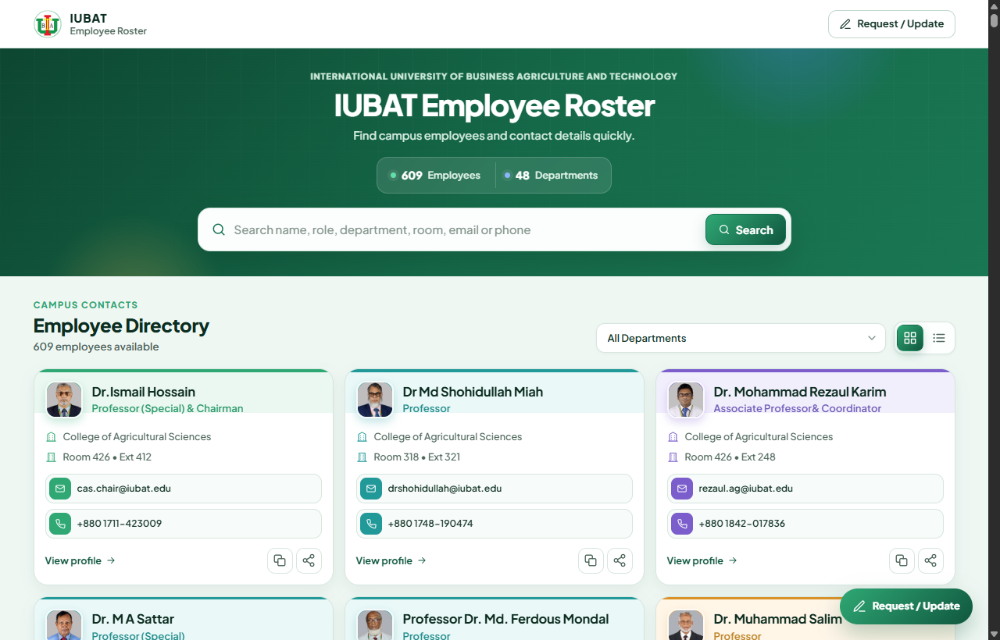

# IUBAT — Faculty & Staff Directory

<p align="center">
  
</p>

<p align="center">
  <strong>International University of Business Agriculture and Technology (IUBAT)</strong><br />
  <em>Fast, modern, and verified campus directory for 605 faculty and staff members.</em>
</p>

<p align="center">
  <a href="https://shawn-cse.github.io/iubat-employee/"></a>
  <a href="https://github.com/shawn-cse/iubat-employee"></a>
  <a href="https://github.com/shawn-cse/iubat-employee"></a>
  <a href="https://github.com/shawn-cse/iubat-employee"></a>
  <a href="LICENSE"></a>
</p>

---

> An ultra-fast, lightweight, and responsive campus directory engineered for the **International University of Business Agriculture and Technology (IUBAT)**. Built with **100% Vanilla HTML5, modern CSS3, and ES6+ JavaScript** with **zero runtime dependencies** and **zero build steps** — delivering near-instant search and contact discovery across **605 verified faculty and staff members**.

---

## 📸 Preview



---

## 🌐 Live Application

Access the official live interactive directory here:  
👉 **[https://shawn-cse.github.io/iubat-employee/](https://shawn-cse.github.io/iubat-employee/)**

---

## ✨ Key Features

- ⚡ **Instant Multi-Field Search:** Real-time tokenized search indexing names, designations, departments, rooms, extensions, emails, phones, and academic study leave status.
- 🏢 **Department Filtering with Member Counts:** Clean, searchable department selector with live headcount badges for every campus division.
- 📱 **Mobile Keyboard-Aware Docking:** When searching on mobile screens, the search bar smoothly docks at the top so results remain 100% visible above virtual keyboards.
- 📇 **Modern Tone-Coded Profile Cards:** High-resolution WebP portraits, quick "View profile" modal, one-click clipboard copy, and native mobile web sharing.
- 🛡️ **Offline Resilience:** Client-side caching (`localStorage`) enables instant re-loads even under slow or disconnected campus networks.
- 🚀 **Zero Dependencies:** Pure web standards with sub-millisecond response times.

---

## 💻 Quick Start

Because modern browsers enforce CORS security on `fetch()` calls over `file://`, serve the directory using Python's built-in server:

```bash
# Start local server on port 8088
python -m http.server 8088
```

Open your browser at: **`http://localhost:8088`**

---

## 👨‍💻 Developer & Maintainer

<table align="center">
  <tr>
    <td align="center">
      <br /><br />
      <strong>Shawn</strong><br />
      <em>Computer Science &amp; Engineering • Full Stack Developer</em><br />
      <strong>International University of Business Agriculture and Technology (IUBAT)</strong>
    </td>
  </tr>
</table>

### 📬 Connect with Shawn
- **GitHub:** [@shawn-cse](https://github.com/shawn-cse)
- **Email:** [shawn.cse@yahoo.com](mailto:shawn.cse@yahoo.com)
- **WhatsApp:** [+880 1873-319733](https://wa.me/8801873319733)
- **Facebook:** [shawnazd](https://facebook.com/shawnazd)
- **Repository:** [github.com/shawn-cse/iubat-employee](https://github.com/shawn-cse/iubat-employee)

---

## 📄 License

This project is open-source and released under the **[MIT License](LICENSE)**. Maintained by **Shawn** for the campus community.
