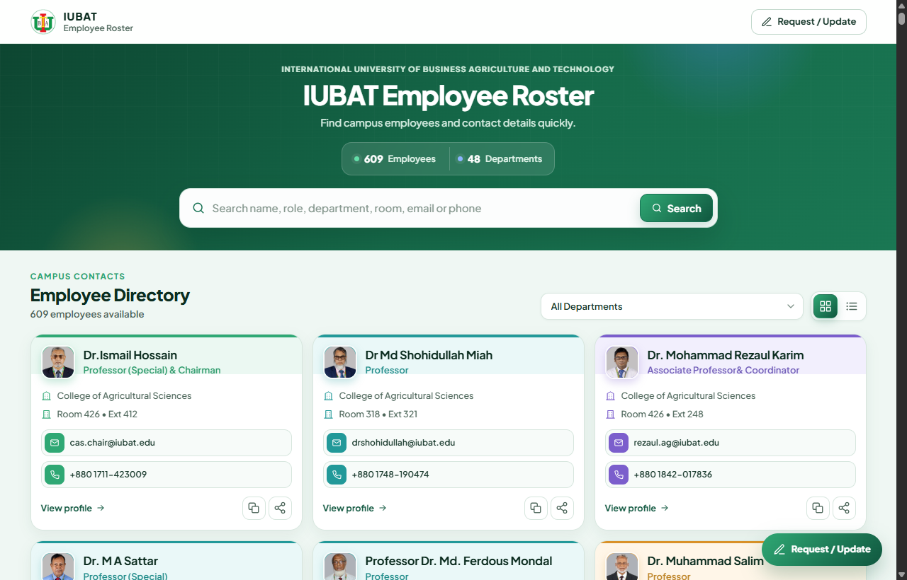
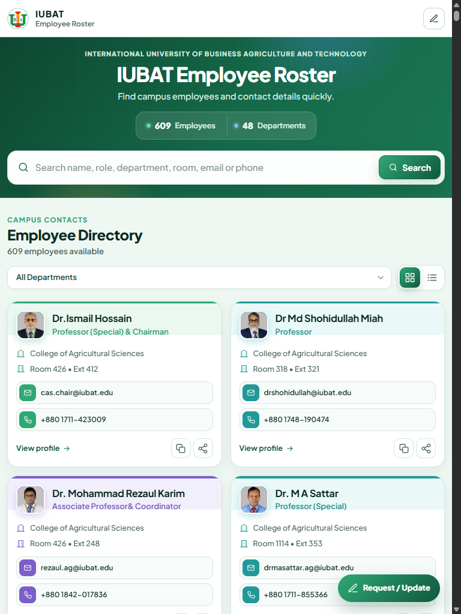
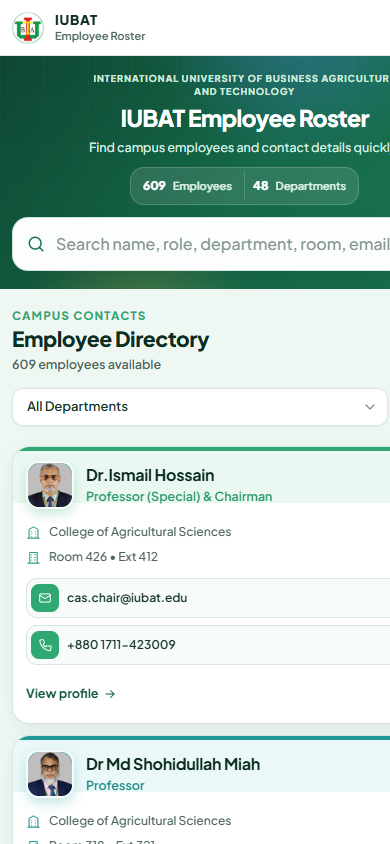
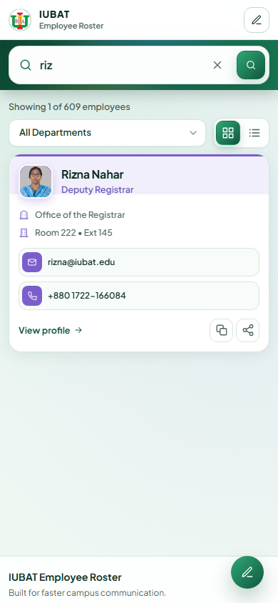

# IUBAT Employee Roster — Faculty & Staff Directory

<p align="center">
  
</p>

<p align="center">
  <strong>International University of Business Agriculture and Technology (IUBAT)</strong><br />
  <em>The First Non-Government University in Bangladesh (Established 1991)</em>
</p>

<p align="center">
  <a href="https://github.com/shawn-cse/iubat-employee"></a>
  <a href="https://github.com/shawn-cse/iubat-employee"></a>
  <a href="https://github.com/shawn-cse/iubat-employee"></a>
  <a href="https://github.com/shawn-cse/iubat-employee"></a>
  <a href="https://github.com/shawn-cse/iubat-employee"></a>
  <a href="LICENSE"></a>
</p>

---

A fast, accessible, responsive, and lightweight faculty and staff directory built for the **International University of Business Agriculture and Technology (IUBAT)**. 

Engineered with **100% Vanilla HTML5, CSS3, and modern ES6+ JavaScript** with **zero third-party runtime dependencies**, **zero npm build steps**, and **zero external UI frameworks**. Delivers near-instant search and contact discovery across **605 verified campus employees**, **48 academic and administrative departments**, and **8 university faculties**.

---

## Visual Showcase

### Desktop Roster View
Crisp, multi-column tone-coded employee cards with lazy-loaded portraits, contact badges, live faculty & department filtering, study leave toggling, and view switching.


---

### Tablet Roster View
Adaptive dual-column layout with fluid touch targets and instant keyboard shortcuts (`/` to search, `Esc` to close modals).


---

### Mobile View & Smart Keyboard-Aware Search UI
| Standard Mobile Roster | Active Search (Above Virtual Keyboard) |
| :---: | :---: |
|  |  |
| *Streamlined hero with instant access to contacts* | *Hero auto-collapses to sticky bar; results stay 100% visible above keyboard* |

---

## 1. Directory Overview & Census Metrics

| Metric | Count | Details |
| :--- | :---: | :--- |
| **Total Verified Personnel** | **605** | 100% verified institutional roster entries |
| **Employees with High-Res Portraits** | **593** | Optimized WebP photographs (`assets/images/emp-*.webp`) |
| **Initial Avatar Fallbacks** | **12** | Clean dynamic monogram avatars with high-contrast palette |
| **Academic Faculties** | **8** | Agricultural Sciences, Business, Engineering, Arts, Sciences, etc. |
| **Departments & Divisions** | **48** | Academic departments, research institutes, and administrative units |
| **Personnel on Academic Study Leave** | **62** | Faculty pursuing higher education or international research |
| **Unique Designations / Roles** | **158** | Professors, Chairs, Registrars, Officers, Technical Staff |
| **Runtime Dependencies** | **0** | Pure vanilla web standards; zero runtime or build overhead |

### Personnel Count by Department

| Department / Division | Personnel | Faculty / Division |
| :--- | :---: | :--- |
| **IUBAT School of Computer Science and Engineering** | **77** | Faculty of Engineering & Technology |
| **School of Business** | **51** | Faculty of Business Administration |
| **Department of English and Modern Languages** | **47** | Faculty of Arts & Social Sciences |
| **Civil Engineering** | **40** | Faculty of Engineering & Technology |
| **College of Agricultural Sciences** | **38** | Faculty of Agricultural Sciences |
| **Electrical and Electronic Engineering** | **29** | Faculty of Engineering & Technology |
| **College of Nursing** | **26** | Faculty of Allied Health Sciences |
| **Mechanical Engineering** | **24** | Faculty of Engineering & Technology |
| **Lab Assistant** | **24** | Administration & Support Services |
| **Department of Mathematics** | **23** | Faculty of Basic Sciences |
| **Office of the Registrar** | **18** | Administration & Support Services |
| **Department of Physics** | **13** | Faculty of Basic Sciences |
| **Computer Education and Training Center (CETC)** | **12** | Administration & Support Services |
| **Bachelor of Arts in Economics** | **11** | Faculty of Arts & Social Sciences |
| **Department of Psychology** | **11** | Faculty of Arts & Social Sciences |
| **College of Tourism and Hospitality Management** | **11** | Faculty of Tourism & Hospitality Management |
| **Construction and Maintenance** | **11** | Administration & Support Services |
| **Department of Statistics** | **9** | Faculty of Basic Sciences |
| **Department of Public Health** | **9** | Faculty of Allied Health Sciences |
| **Proctor's Office** | **9** | Administration & Support Services |
| **Department of Environmental Science** | **8** | Faculty of Basic Sciences |
| **Accounts and Audit** | **8** | Administration & Support Services |
| **Library** | **8** | Administration & Support Services |
| **Department of Chemistry** | **7** | Faculty of Basic Sciences |
| **Branding and Public Relations Office** | **7** | Administration & Support Services |
| **Technical Training Unit** | **6** | Administration & Support Services |
| **Admission Office** | **6** | Administration & Support Services |
| **College of Arts and Science** | **6** | Faculty of Arts & Social Sciences |
| **Innovation Centre** | **5** | Administration & Support Services |
| **Department of Philosophy** | **4** | Faculty of Arts & Social Sciences |
| **Office of Ranking & Recognition** | **4** | Administration & Support Services |
| **Professor Mahmuda Khanum Healthcare Centre** | **4** | Administration & Support Services |
| **University Education Extension Unit (UEEU-KBAD)** | **4** | Administration & Support Services |
| **IQAC Office** | **4** | Administration & Support Services |
| **Human Resource Department** | **3** | Administration & Support Services |
| **Procurement Office** | **3** | Administration & Support Services |
| **International Program Office** | **3** | Administration & Support Services |
| **Automation** | **3** | Administration & Support Services |
| **Transport Division** | **3** | Administration & Support Services |
| **Vice Chancellor's Office** | **2** | Administration & Support Services |
| **Pro Vice Chancellor's Office** | **2** | Administration & Support Services |
| **Controller of Examinations** | **2** | Administration & Support Services |
| **Miyan Research Institute** | **2** | Administration & Support Services |
| **Reception** | **2** | Administration & Support Services |
| **Telephone Exchange (PABX)** | **2** | Administration & Support Services |
| **Lift Operating** | **2** | Administration & Support Services |
| **Alumni Office** | **1** | Administration & Support Services |
| **Photocopy** | **1** | Administration & Support Services |

---

## 2. Key Features & Architectural Highlights

### 📱 Smart Mobile Keyboard Occlusion Fix
On smartphones, opening the virtual keyboard typically consumes 40–50% of vertical screen height. Standard headers push search results off-screen:
- **Auto-Docking Hero:** When the search input is focused or typed into on mobile screens (`<= 768px`), the university hero banner automatically collapses into a **slim 52px sticky search bar**.
- **Compact Results Counter:** The directory summary allocates visible viewport height directly to result cards.
- **Smooth Auto-Scroll:** Typing automatically aligns the search bar to the top of the viewport so users immediately see employee results as they type.
- **Auto-Zoom Prevention:** Search input is styled with `font-size: 16px` on mobile, preventing mobile Safari and Chrome from jarringly zooming into the page.

### ⚡ Instant Multi-Field Client-Side Search
- Searches across **14 distinct attributes** simultaneously: Name, Designation, Department, Faculty, Section, Office Room, Phone Extension, Email Address, Mobile Number, Qualifications, Additional Responsibility, Institutional Affiliation, Present Address, and Study Leave status.
- Tokenized query matching: multi-word searches (e.g. `ismail cas` or `rezaul coordinator`) match regardless of word order.
- Debounced with `requestAnimationFrame` for smooth 60 FPS typing response.
- **URL Deep-Linking:** Supports initial query strings (`?q=rizna`, `?faculty=Engineering`, `?dept=CSE`, or `?studyleave=1`) to allow sharing direct links to specific employees, departments, or leave cohorts.
- Pressing `/` anywhere on desktop instantly focuses and selects the search input.

### 🏛️ Hierarchical Faculty & Department Filtering
- Two-tier filter system: Filter by academic **Faculty** (8 faculties) or narrow down to a specific **Department** (48 departments).
- When a faculty is selected, the department filter dynamically updates to display departments within that faculty.
- Dedicated **Study Leave** quick filter button lets students and administrators toggle between campus-active personnel and faculty abroad on research leave.

### 🎨 Modern Typography & Color-Coded Tone Cards
- **Plus Jakarta Sans:** Crisp geometric sans-serif typeface with weights ranging from 400 to 800.
- **6 Tone Variants:** Cards dynamically rotate through 6 cohesive border and tint themes (Emerald Green, Teal, Indigo Blue, Violet, Amber Gold, Rose).
- **View Toggle:** Seamlessly switch between **Card Grid View** and compact **List View** with preferences saved to `localStorage`.

### 📋 One-Click Copy & Native Web Share
- **Copy Details:** Formats employee name, role, department, room, phone, and email into clean text and copies directly to the clipboard with an animated status toast.
- **Native Web Share:** Leverages `navigator.share` on mobile devices for sharing to WhatsApp, Messenger, or SMS, with seamless clipboard fallback on desktop.

### 🛡️ Offline Resilience & Fast Caching
- Saves directory data locally to `localStorage` (versioned `iubat_employee_directory_cache_v4`) on initial load. If network connectivity drops or the user revisits offline, the directory loads instantly with a discreet notification.

---

## 3. Database Rebuild & Integration Architecture

The authoritative data source for the directory is the newly integrated **`iubat faculty database/`** containing `IUBAT.html` and `IUBAT_files/`.

### Source Analysis & Data Integrity Improvements

1. **Accurate Personnel Headcount:**
   - The previous `employees.json` contained 609 records, including 8 departed individuals who are no longer on the university roster (e.g., Fuad Ahmed Udoy, Iftekhar Sanwar Talukdar, Nashia Alam Liana, Mahfuz Auyon, Md. Arafath Rahman Nishat, Md. Sarowar Kamal Bhuiyan, Emtiaz Ahamed Mainul, Md.Abdul Ali).
   - The new database introduced 4 newly appointed/joined faculty members who were missing in the previous roster (`Dr. Md. Akhtaruzzaman`, `Dr. Fatema Nasrin Jahan`, `Sifat Howlader`, `Mahmudul Hasan`).
   - The verified roster now contains exactly **605 active personnel**.

2. **Resolution of Data Inconsistencies:**
   - **Name Truncation Fixed:** Resolved truncated names from the old dataset (e.g. `Professor Dr. Engr. Mohammad Abu` -> `Professor Dr. Engr. Mohammad Abu Eusuf`; `Professor Dr. Dewan Muhammad` -> `Professor Dr. Dewan Muhammad Nuruzzaman`).
   - **Degree & Title Updates:** Updated faculty records who earned doctorates (e.g., `Md Shafiqul Islam` -> `Dr. Md. Shafiqul Islam`; `Md Saiduzzaman` -> `Dr. Md. Saiduzzaman`; `Moniruzzaman Bhuyan` -> `Dr. Md. Moniruzzaman Bhuyan`). Corrected typos (`Drs. Sadiya Akhter` -> `Dr. Sadiya Akhter`).
   - **Canonical Department Normalization:** Standardized uppercase names (e.g. `OFFICE OF THE REGISTRAR` -> `Office of the Registrar`), fixed backtick typos (`Proctor`s Office` -> `Proctor's Office`), and normalized spacing (`UEEU-KBAD`).
   - **Affiliation Extraction:** Separated external institutions from department names for Adjunct Research Fellows (e.g. `Universiti Sains Malaysia`, `University of Leicester Business School`).
   - **Study Leave Tracking:** Extracted study leave statuses (62 faculty members) into dedicated flags and visual badges.

3. **Portrait Optimization & Sync:**
   - All 593 portrait images from `iubat faculty database/IUBAT_files/` were converted into high-performance, responsive WebP assets (`assets/images/emp-001.webp` through `emp-605.webp`) using LANCZOS resampling and quality compression.
   - For 12 personnel with institutional placeholder avatars, high-contrast dynamic SVG initials avatars are served.

### Rebuilding the Database

To rebuild or refresh the database from `iubat faculty database/IUBAT.html`:

```bash
python scripts/rebuild_database.py
```

This automated script performs data extraction, canonical normalization, portrait WebP conversion, and atomic updates to `data/employees.json`.

---

## 4. Complete Repository Structure

```text
iubat-employee-main/
│
├── .editorconfig                        # Clean indentation & line endings rules across IDEs
├── .gitattributes                       # Cross-platform LF text & binary attributes
├── .gitignore                           # Standard git ignores (OS files, logs, caches)
├── 404.html                             # Custom branded 404 error page
├── LICENSE                              # MIT Open Source License
├── package.json                         # Node/NPM developer scripts (start, test, rebuild, export)
├── README.md                            # Comprehensive project overview & documentation
├── robots.txt                           # Search engine crawling directives
├── sitemap.xml                          # Search engine XML sitemap
├── index.html                           # Main interactive directory single-page application
│
├── assets/                              # Static vectors, branding, manifests, and portraits
│   ├── favicon.svg                      # Scalable SVG university crest favicon
│   ├── site.webmanifest                 # PWA mobile installation & theme manifest
│   └── images/
│       ├── logo.png                     # Official IUBAT crest (PNG)
│       └── emp-001.webp - emp-605.webp  # Extracted high-quality WebP portraits (593 files)
│
├── css/                                 # Style architecture
│   ├── styles.css                       # Core design system tokens, typography, hero & cards
│   ├── responsive.css                   # Responsive breakpoints & mobile keyboard handling
│   └── print.css                        # Paper-friendly print and PDF export stylesheet
│
├── data/                                # Persistence & export layer
│   ├── employees.json                   # Authoritative normalized dataset (605 verified records)
│   ├── employees.csv                    # UTF-8 BOM Excel-compatible spreadsheet export
│   └── backup/
│       ├── employees.backup.json        # Preserved previous dataset backup (609 records)
│       └── images_old/                  # Preserved legacy image assets
│
├── docs/                                # Detailed technical specifications
│   ├── ARCHITECTURE.md                  # Comprehensive architectural blueprint & design principles
│   ├── DATABASE_SCHEMA.md               # Data dictionary, field constraints & reconciliation notes
│   └── CONTRIBUTING.md                  # Developer guidelines, code standards & testing workflow
│
├── js/                                  # Runtime application logic
│   └── app.js                           # State manager, search engine, filter cascade, modal
│
├── scripts/                             # Automation, validation & export pipeline
│   ├── rebuild_database.py              # Ingestion pipeline: parses HTML, normalizes & encodes WebP
│   ├── verify_database.py               # Automated 605-record assertion & integrity test suite
│   └── export_csv.py                    # CSV conversion utility for administrative records
│
├── iubat faculty database/              # Original authoritative source files (preserved intact)
│   ├── IUBAT.html                       # Raw internal university roster HTML export
│   └── IUBAT_files/                     # Original portrait photographs and assets (585 files)
│
└── screenshots/                         # High-resolution documentation screenshots
    ├── desktop-roster.png               # Desktop grid view (1280x820)
    ├── tablet-roster.png                # Tablet view (768x1024)
    ├── mobile-roster.png                # Standard mobile view (390x844)
    └── mobile-search.png                # Mobile search view above on-screen keyboard
```

---

## 5. Developer Commands & Local Execution

Because modern browsers enforce CORS security on `fetch()` calls when opened via the `file://` protocol, serve the project folder using any static web server:

### Option 1: Python Built-in Server (Recommended)

```bash
# Start local server on port 8088
python -m http.server 8088
```
Open your browser and navigate to: **`http://localhost:8088/`**

### Option 2: NPM / Node.js Scripts (Zero Dependencies)

If you have Node.js / npm installed:
```bash
# Start dev server
npm start

# Run database & asset verification test suite
npm test

# Rebuild database from source HTML and convert portraits
npm run rebuild

# Export clean UTF-8 CSV spreadsheet
npm run export:csv
```

### Option 3: VS Code Live Server Extension

1. Open the `iubat-employee-main` folder in **VS Code**.
2. Right-click [`index.html`](file:///d:/001_LO/Coding/iubat-employee-main/index.html) and select **Open with Live Server**.

### Option 4: Docker / Nginx Container

```bash
docker run --rm -p 8088:80 -v $(pwd):/usr/share/nginx/html:ro nginx:alpine
```

---

## 6. Developer Information

<table align="center">
  <tr>
    <td align="center">
      <br />
      <strong>Shawn</strong><br />
      <em>Software Engineer & Web Developer</em><br />
      Department of Computer Science and Engineering (CSE)<br />
      <strong>International University of Business Agriculture and Technology (IUBAT)</strong>
    </td>
  </tr>
</table>

### Connect & Support

- **GitHub:** [@shawn-cse](https://github.com/shawn-cse)
- **Email:** [shawn.cse@yahoo.com](mailto:shawn.cse@yahoo.com)
- **Facebook:** [shawnazd](https://facebook.com/shawnazd)
- **WhatsApp:** [+880 1873-319733](https://wa.me/8801873319733)
- **Project Repository:** [github.com/shawn-cse/iubat-employee](https://github.com/shawn-cse/iubat-employee)

Have an update for an employee listing, room change, or new joining? Use the in-app **Request / Update** button or contact directly via Email or WhatsApp.

---

## 7. License & Disclaimer

This project is open-source and released under the **[MIT License](LICENSE)**.

*Employee data, photographs, and university insignias are the intellectual property of the **International University of Business Agriculture and Technology (IUBAT)**. This application is an independent, non-official directory project built to empower students, faculty, and campus staff with fast, accessible communication.*
