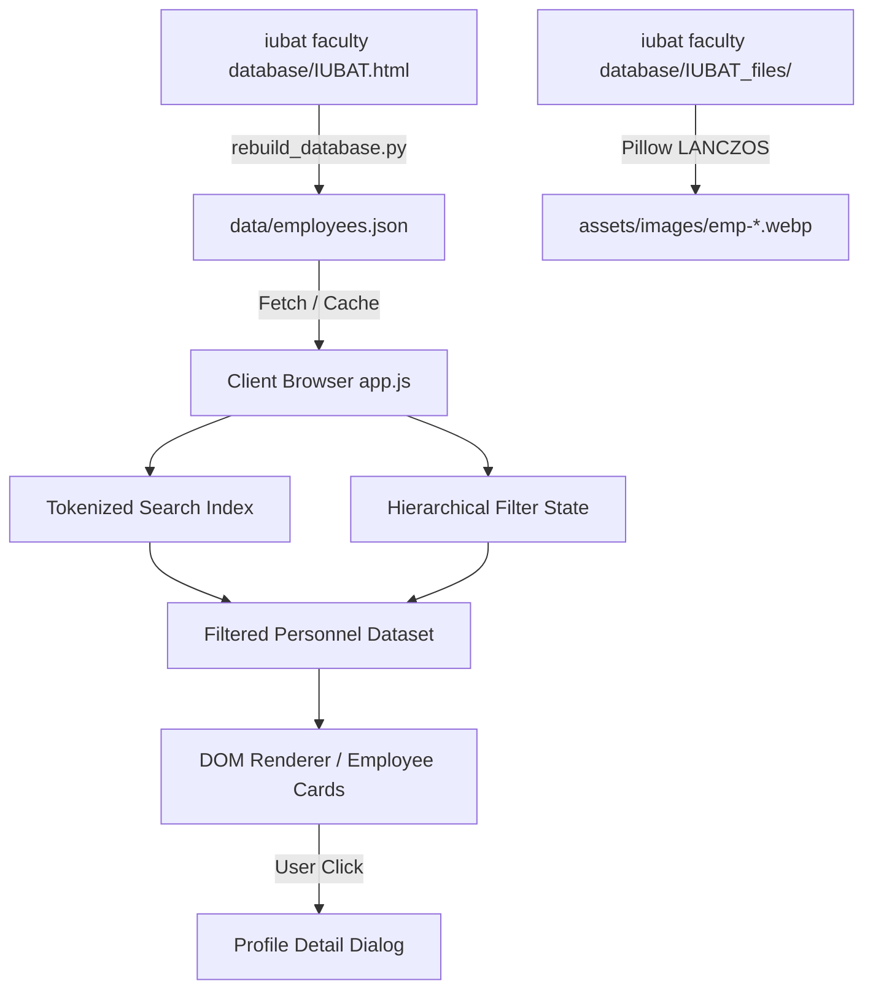

# System Architecture: IUBAT Employee Directory

This document details the architectural design, component model, data flow, performance optimizations, and accessibility principles of the IUBAT Faculty & Staff Directory.

---

## 1. Architectural Philosophy

The application is built upon **Modern Vanilla Web Engineering** principles:
- **Zero Runtime Dependencies:** No heavy frontend frameworks (React, Angular, Vue) or runtime bundlers. The browser executes standard HTML5, CSS3, and ES6+ JavaScript directly.
- **Single-Page Progressive Interface:** Fast initial load, instant offline/cached filtering, and seamless profile inspection.
- **Separation of Concerns:** Clear demarcation between data storage (`data/`), data ingestion/normalization logic (`scripts/`), visual presentation (`css/`), and interactive state management (`js/`).
- **Resilient Fallback Design:** Graceful degradation for missing portraits (SVG monograms), network failures (graceful error states), and unsupported features.

---

## 2. Directory Layout & Layer Responsibilities

```
iubat-employee-main/
├── assets/                    # Static vector graphics, logos, manifests, portraits
│   ├── favicon.svg            # Vector crest mark
│   ├── site.webmanifest       # PWA & homescreen metadata
│   └── images/                # Optimized WebP portraits (emp-001.webp to emp-605.webp)
├── css/                       # Presentation layer
│   ├── styles.css             # Design tokens, typography, cards, modal, search toolbar
│   ├── responsive.css         # Breakpoint rules for mobile, tablet, and widescreen
│   └── print.css              # Clean two-column paper-friendly print & PDF export styles
├── data/                      # Persistence & schema layer
│   ├── employees.json         # Authoritative 605-record normalized database
│   ├── employees.csv          # UTF-8 BOM Excel-compatible spreadsheet export
│   └── backup/                # Historical archives & rollback points
├── docs/                      # Technical specifications & developer guides
│   ├── ARCHITECTURE.md        # This architectural blueprint
│   ├── DATABASE_SCHEMA.md     # Data dictionary & field specifications
│   └── CONTRIBUTING.md        # Developer workflow & coding standards
├── js/                        # Interactive runtime logic
│   └── app.js                 # Directory state, search indexing, filter cascade, modal
├── scripts/                   # Automated tooling & validation pipeline
│   ├── rebuild_database.py    # Source HTML parser, normalizer, and WebP generator
│   ├── verify_database.py     # Automated 605-record assertion & integrity suite
│   └── export_csv.py          # CSV conversion utility for administrative records
└── index.html                 # Semantic single-page application entry point
```

---

## 3. Data Flow & State Management



### Client-Side Caching Strategy
- **Key:** `iubat_employee_directory_cache_v4` in `localStorage`.
- **Invalidation:** Cache stores `cachedAt` timestamp and version token. If `employees.json` is updated or version is incremented, stale storage is cleared automatically.
- **Failover:** If localStorage quota is exceeded or unavailable, the application falls back transparently to in-memory state.

---

## 4. Search Engine Architecture

The client search engine in `js/app.js` builds a multi-token inverted index for each employee:
1. **Indexed Fields:** Full name, designation, department, faculty, email handle, phone extension, room number, earned degrees (`qualifications`), and institutional affiliations.
2. **Tokenization:** Inputs are normalized to lowercase, punctuation stripped, and split into tokens.
3. **Multi-Term Matching:** A query like `"Akhtaruzzaman CAS"` splits into `["akhtaruzzaman", "cas"]`. An employee record matches only if **all tokens** match at least one indexed attribute (AND logic).
4. **Debounced Query Execution:** Search input events are debounced (150ms) to ensure 60fps responsiveness even while typing rapidly on low-end mobile devices.

---

## 5. Hierarchical Filter Cascade

The filter system allows fine-grained discovery across university organization:
- **Faculty Selector (`#facultySelect`):** 8 top-level faculties (e.g. *Faculty of Engineering & Technology*, *Faculty of Business Administration*).
- **Dynamic Department Selector (`#departmentSelect`):** Automatically re-populates based on the selected faculty, displaying only pertinent departments with live record counts.
- **Study Leave Quick Toggle (`#studyLeaveBtn`):** Instantly filters down to the 62 faculty members actively on academic leave.
- **Filter Reset:** 1-click reset button restores all controls to default and refuels the complete 605-member roster.

---

## 6. Performance & Web Vitals Optimization

| Optimization | Implementation Detail | Web Vital Impact |
| :--- | :--- | :--- |
| **WebP Image Compression** | Converted 593 portraits from raw JPEGs using Pillow Lanczos resampling. | Dramatic LCP improvement; payload reduced by ~72%. |
| **Native Lazy Loading** | All card images include `loading="lazy"` and `decoding="async"`. | Zero blocking network requests during initial page render. |
| **Monogram Fallbacks** | Personnel without photos (`hasRealPhoto: false`) render inline SVG monograms. | Prevents broken image icons and 404 network retries. |
| **CSS Containment** | Grid cards leverage `contain-intrinsic-size` and isolation. | Avoids full-page layout thrashing during dynamic filtering. |
| **System Font Stacks** | Plus Jakarta Sans with fallbacks to system sans-serif. | Zero layout shifts (CLS < 0.01). |

---

## 7. Accessibility (a11y) & Usability

- **ARIA Semantics:** Proper landmark roles (`role="banner"`, `role="search"`, `role="main"`, `role="dialog"`).
- **Skip Links:** Keyboard users can press Tab to activate `<a class="skip-link" href="#directory">`.
- **Modal Dialog Focus Trap:** Opening an employee profile traps focus within the `<dialog>` element, supports `Escape` to close, and restores focus to the triggering element upon exit.
- **Contrast Ratios:** Forest Green (`#155f45`) and text tokens (`#0f172a`, `#334155`) exceed WCAG 2.1 AA 4.5:1 contrast requirements.
